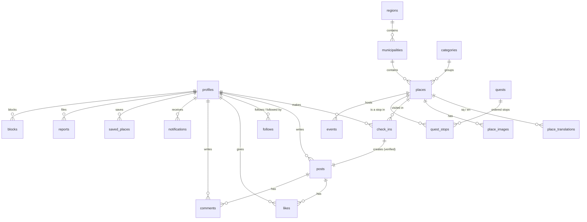

# Architecture

This is the technical reference for Discover Kosovo. It covers the repository layout, data model, check-in verification and environments. Decisions are recorded as ADRs in [`docs/adr/`](adr/). Stack choices and the reasons for them are in the [project plan](PROJECT-PLAN.md#5-architecture-and-tech-stack).

## Repository layout

```text
apps/
  mobile/          Expo app (Expo Router): app/(tabs)/home · explore · check-in · passport · profile
  web/             Next.js: /admin (CMS + moderation), /u/[username] (public profile), / (landing)
packages/
  shared/          Supabase-generated types, zod schemas, constants, design tokens (theme)
supabase/
  migrations/      SQL: schema, RLS policies, functions, triggers (the only way the DB changes)
  functions/       Edge Functions (Deno), e.g. AI photo check (P2)
  seed.sql         Regions, municipalities, categories, demo data
data/              Place CSVs per region, import scripts (OSM / Wikidata), image attributions
design/            Exported assets: icons, stamps, map style JSON, tokens.json
docs/              Plan, architecture, ADRs, design research, sprint reviews
.github/           CI workflows, issue/PR templates, CODEOWNERS
```

**Ownership** (enforced as review requests through `.github/CODEOWNERS`): `supabase/` → Elios · `apps/web/` → Artiola · `apps/mobile/` → Erleta, Elvina, Krenare by feature folder · `design/`, `packages/shared/theme` → Rinor.

## Data model



| Table | Key columns |
| --- | --- |
| `profiles` | `id` (= `auth.users.id`), `username` (unique), `display_name`, `avatar_url`, `bio`, `home_municipality_id`, `diaspora_country`, `university`, `role` (`user`/`admin`), `xp`, `is_private` |
| `regions` / `municipalities` | `name_sq`, `name_en`, `slug`, `geom` (multipolygon from geoBoundaries) |
| `places` | `slug`, `municipality_id`, `category_id`, `location geography(Point, 4326)`, `checkin_radius_m` (default 100), `status` (`draft`/`published`), `cover_image_url` |
| `place_translations` | `place_id`, `locale` (`sq`/`en`), `name`, `short_description`, `description` |
| `place_images` | `url`, `author`, `license`, `source_url` (attribution is mandatory) |
| `check_ins` | `user_id`, `place_id`, `location`, `accuracy_m`, `photo_path`, `status` (`valid`/`flagged`/`revoked`), `created_at` |
| `posts` | `user_id`, `check_in_id`, `place_id`, `caption`, `photo_path`, `like_count`, `comment_count` (kept by triggers) |
| `likes`, `comments`, `follows`, `saved_places`, `blocks` | Join tables with composite keys and RLS |
| `notifications` | `user_id`, `actor_id`, `type` (`like`/`comment`/`follow`/`friend_checkin`), `post_id`, `read_at` (filled by triggers) |
| `quests` / `quest_stops` | Translated title and description, `xp_reward`, ordered `position` |
| `events` | `place_id`, `starts_at`, `ends_at`, festival stamp artwork |
| `reports` | `reporter_id`, `target_type` (`post`/`comment`/`user`), `target_id`, `reason`, `status` |

**Stamps are not a table.** A stamp is the user's first `valid` check-in at a place, exposed through the views `user_stamps` and `user_region_progress`.

**Security:** RLS is on for every table. Users write only their own rows. Admin-only tables and actions check `profiles.role = 'admin'`. Posts by blocked users are filtered out in the feed function.

## Check-in verification

```mermaid
sequenceDiagram
  actor U as User
  participant App as Mobile app
  participant St as Storage
  participant DB as Postgres (create_check_in)
  U->>App: Opens the place and taps "Check in" (shown only inside the radius)
  App->>App: In-app camera only (no gallery), reads GPS, accuracy and the Android mocked flag
  App->>St: Uploads the compressed photo to post-photos/{user_id}/…
  App->>DB: rpc create_check_in(place_id, lat, lng, accuracy, mocked, photo_path, caption)
  DB->>DB: Rejects if mocked, accuracy > 75 m, or ST_DWithin(place, point, radius) fails
  DB->>DB: Rate limit (max 10/hour) and impossible-travel check (> 150 km/h since the last check-in)
  DB-->>App: check_in + post + stamp + XP in one transaction
  App-->>U: Stamp animation and haptics; the post appears in followers' feeds
```

In **demo mode** (an admin-enabled flag on the account), the location comes from the simulator and is accepted, and the post is tagged `demo`. In P2, an Edge Function compares the photo with the place's reference image and flags mismatches for moderators without blocking the user.

## Key API (SQL functions called with `supabase.rpc`)

| Function | Used by |
| --- | --- |
| `places_in_bbox(min_lng, min_lat, max_lng, max_lat, category?)` | Explore map |
| `places_nearby(lat, lng, radius_m)` | List view, "near you" |
| `place_detail(slug, locale)` | Place detail |
| `create_check_in(…)` | Check-in |
| `feed(tab, cursor, limit)`: `following` / `community` | Home feed |
| `user_region_progress(user_id)` | Passport, fog of war |
| `leaderboard(scope, period)`: `friends` / `city` / `university` | Leaderboards |

## Environments

| Environment | Backend | Mobile | Web |
| --- | --- | --- | --- |
| Local | Supabase CLI (Docker), or the shared dev project | Development build + `expo start` | `next dev` |
| Dev (shared) | Supabase project `discover-kosovo-dev` | Development build APK | Vercel preview per PR |
| Production | Supabase project `discover-kosovo-prod` | EAS production APK (release) | Vercel production |

Secrets live only in `.env` files, which git ignores, and in Vercel/EAS settings. Only the Supabase **anon** key goes into the apps; the **service role** key never leaves server code.
