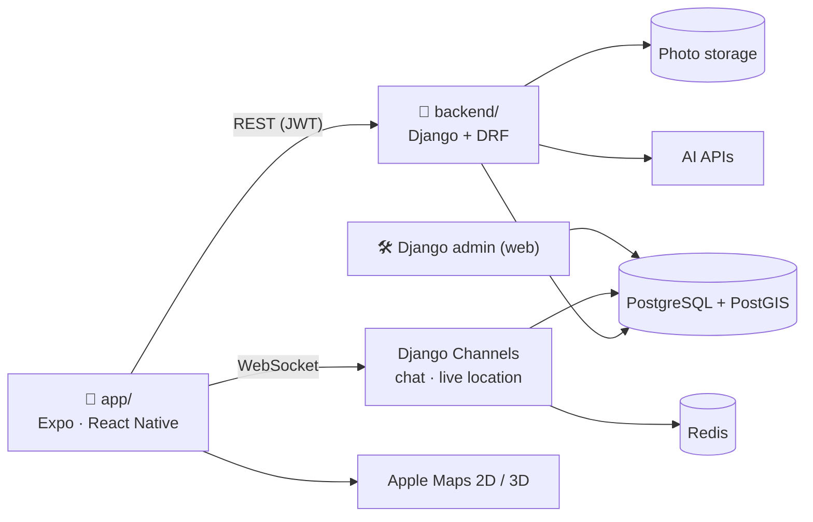

# Discover Kosovo: Project Plan

> **Team:** CommitCrew · **Course:** Menaxhimi i Projekteve (Prof. Lorent Sinani) · **Board:** [GitHub Project](https://github.com/users/rinorze/projects/1)
> **Timeline:** 11 weekly sprints, 19 Oct 2026 → 10 Jan 2027 (holiday break 28 Dec – 3 Jan)
> **Every feature with a screen mockup:** [Feature Atlas](https://claude.ai/artifact/Fh1ASH9JErhpenqCUmFxGw)

This plan describes **what** we build and **who builds what each week**. Every cell in section 6 is one card on the board: **one card per person per week**.

---

## 1. The product

**Discover Kosovo is a discovering and travelling app for all 38 municipalities of Kosovo that feels like social media, without posts, likes or comments.**

You pick a city, find places on a 2D/3D map, go there and unlock each place with the in-app camera. Your friends see what you unlocked, where you are (only if you share), and you explore together: chat, trips, postcards, streaks, quests and festivals.

**Core loop:** *a friend unlocks a place → you see it in your activity → you plan it together in chat → you go → you unlock it → your friends see it → they want to go too.*

**Product principles**
1. **Real visits only.** An unlock needs the in-app camera and your GPS inside the place's radius, checked on the server.
2. **Social without a feed.** No posts, likes or comments. The social feeling comes from people's real actions: automatic activity, presence on the map, chat, trips, postcards, streaks, quests, leagues and events.
3. **All of Kosovo.** Every municipality has a city page, even the smallest ones (Partesh, Junik, Mamushë).
4. **Beautiful and simple.** Big photos, rounded cards and glass buttons, in an iOS feel, with Albanian and English everywhere.
5. **Private by default.** Location sharing is off until you turn it on, and ghost mode is one tap away.

---

## 2. What the research says

Research was done with Claude, ChatGPT (Codex), Grok 4.7 and Cursor Composer, then checked.

| App | What we take |
| --- | --- |
| **Snap Map, Bump (Zenly)** | Friends on a map, ghost mode, "bump" when you meet, best friends |
| **Find My, Life360, Apple Check In** | Timed sharing, circles, "arrive safely" for hikes |
| **Duolingo** | Friend streaks, weekly friend quests, leagues, nudges |
| **Pokémon GO** | Going to real places to collect, friend codes, gifts (postcards), co-op places |
| **Apple Fitness, Strava** | Today rings, 7-day races, clubs and challenges |
| **Swarm / Foursquare** | Unlock = check-in with proof; "keeper of the place" among friends |
| **Spotify** | Blend (a route made for two friends), Wrapped (your year in Kosovo) |
| **Partiful, Facebook events** | "I'm going" and which friends are going |
| **Fog of World, Been** | The map clears as you explore; % of Kosovo discovered |
| **Wanderlog, Mindtrip** | AI day plans shown as place cards and a route |
| **Visit Kosovo, Dardania Live, EduPrizrenin** | Content sources, but **no** unlocks, friends or chat: that gap is our opportunity |

**Key decisions**
- **Backend: Python with Django** (+ Django REST Framework, GeoDjango, Django Channels). The built-in admin is our content and moderation panel, GeoDjango + PostGIS does the distance checks, and Channels gives real-time chat and location.
- **Database: PostgreSQL + PostGIS**, plus **Redis** for real time.
- **Maps: Apple Maps** through `react-native-maps` (MapKit): 2D, a tilted 3D satellite view, and it runs in Expo Go, so the whole team can test without a development build. Mapbox stays the option if we later need 3D terrain.
- **AI runs only on the backend**, and only recommends places that exist in our database. The Gemini free tier is not available in Kosovo, so we budget a small paid key or student credit.
- **Friends on the map:** off by default, friends only, ghost mode, precision (city / ~1 km / exact), timed sharing (1 hour, tonight, until off), no history, no strangers.

**UX rules**
- Ask for each permission in context (location when the map opens, camera on the first unlock), never all at once. The app works with no permissions.
- An unlock never creates a public post. Your unlock photos are private; you can send one to a friend as a postcard.
- Religious and memorial places (Deçan, the Patriarchate of Peja, Graçanica, Prekaz) get a respect card and no confetti, points or meetups.

**Ideas unique to Kosovo:** Kthimi (homecoming) mode for the diaspora · one stamp in each of the 38 municipalities · festival stamps (DokuFest, Sunny Hill, Anibar, Hardh Fest) · Rugova and Sharr in two seasons · Çarshia "open now" · co-op places that need two friends.

**Design direction (Rinor):** big full-bleed photos in 24 px rounded cards, frosted glass buttons, a hero card with *View more*, a *Discover* carousel and a 2-column grid of city cards. Palette: limestone `#F6F3EE`, ink `#1A1814`, Kosovo blue `#1E4B99`, flag gold `#C6A15B` (stamps), pine `#1B6B45` (unlocked). We say *unlock* and *stamps*, never "earn" or "passport".

---

## 3. Features

The **[Feature Atlas](https://claude.ai/artifact/Fh1ASH9JErhpenqCUmFxGw)** lists every feature, from the splash screen to the admin panel, with a mockup, difficulty (Easy / Medium / Hard), phase (MVP / Later) and owner. You can filter it by person.

| Module | MVP (final demo) | Later |
| --- | --- | --- |
| Welcome & account | Splash, welcome slides, language, sign up, log in, profile, home town, interests, permissions, find friends | Google/Apple sign-in, tour |
| Home | Friends nearby, friend activity, place of the day, continue exploring | Weather, weekend ideas, Kthimi |
| Explore 38 cities | Cities grid, search, city page, facts, categories, saved places | Collections, hidden gems |
| Place page | Photos, story sq/en, practical info, directions, unlock button, friends who unlocked, nearby, respect card | Audio story |
| Map 2D & 3D | Map with pins, 3D mode, place sheet, filters, friends on the map, my location | Fog, borders by progress, satellite |
| Unlock & collection | Unlock camera, not in range, server verification, "Unlocked!", collection, stamp detail, city completed, regions | Then & Now, offline unlock, QR in museums |
| Friends & together | Friends list, add by code, requests, friend profile, postcards, block/report, friend streak, friend quest | Bump, best friends, co-op places, keeper, blend, meetups, circles, arrive safely |
| Chat & trips | Chats, real-time chat, share a place, trip group chat, create a trip, trip checklist | Meet here, group unlock, trip recap |
| Challenges | Weekly challenges, streak, friends leaderboard, achievements, XP | Leagues, trivia, 7-day race |
| Events | Calendar, event page with "I'm going" | Festival stamps, festival map |
| AI | Ask Kosovo, Plan my day | Route on the map, photo check, translation |
| Profile & settings | Profile, stats, edit, private memories, settings, ghost mode, notifications, language, blocked users, privacy, delete account | Share card, help |
| Admin (web) | Cities and places, events, moderation, demo mode | — |

---

## 4. Navigation

**Tabs:** `Home` · `Explore` · `⊕ Unlock` (gold camera button) · `Map` · `You`. The Home header has 💬 chats and 🔔 notifications, and Explore has ✨ *Ask Kosovo*.

---

## 5. Team: who does what

Three members have little coding experience, so the work is split by difficulty:

| Member | Role | Level |
| --- | --- | --- |
| **Rinor Zeqiri** | Product Designer + hard frontend: designs every screen, builds the shared components, Home, the map, the camera unlock and the animations; Docker and the database; reviews every pull request | Hard |
| **Elios Mernica** | Backend lead: Django API, sign-in, unlock checks, friends, real-time chat and location, AI, notifications, deploys | Hard |
| **Artiola Ferizi** | Screens: onboarding (welcome, look around, guest place, language, sign in), then profile and settings | Easy |
| **Erleta Qerimi** | Screens: onboarding (where are you today, Kthimi, interests, save passport, privacy), then cities, search, events | Easy |
| **Elvina Sinani** | Screens: onboarding (avatar creator, avatar items, one friend, first km), then place page, collection, chat | Easy |
| **Krenare Veseli** | The website (landing page, waiting list, app page) · Scrum Master · then friends, postcards and trips screens | Easy |

**How beginners work:** build each screen with Rinor's components and **mock data** first (it looks finished on day 1), then connect it to Elios's API together with him.

**Content for all 38 municipalities** (photo, sq/en text, at least 3 places each) is entered in the Django admin by the beginners:
Krenare → Prishtinë region (8) and Mitrovicë region (7) · Artiola → Prizren region (5) · Erleta → Pejë region (3) and Gjakovë region (4) · Elvina → Ferizaj region (5) and Gjilan region (6).

---

## 6. Week by week

| Sprint | Rinor | Elios | Krenare | Artiola | Erleta | Elvina |
| --- | --- | --- | --- | --- | --- | --- |
| **1** 19–25 Oct · Kickoff | MVP to the professor, research, flows, wireframes, Expo app with 5 tabs | Django + PostGIS set-up | Working agreement; learn React Native | Learn RN; static welcome screen | Learn RN; static city card | Learn RN; static stamp |
| **2** 26 Oct–1 Nov · Onboarding | Design system, hi-fi onboarding, shared components | Sign-in API | Where is home?, Find friends | Splash, welcome, language, sign up, log in | Cities grid (38) | Permissions, profile setup, interests |
| **3** 2–8 Nov · Cities & places | Hi-fi explore/place/map; sign-in flow | Cities & places API, admin, seed 38 | Friends list; content: Prishtinë | Connect sign up/log in; content: Prizren | City page, facts, categories | Place page |
| **4** 9–15 Nov · Map & content | **Map 2D/3D**, place sheet | **Unlock API** | Add friend, requests; content: Mitrovicë | Profile, edit profile, stats | Search, saved, nearby; content: Pejë, Gjakovë | Collection, stamp detail, not in range; content: Ferizaj, Gjilan |
| **5** 16–22 Nov · Unlock & collection | **Unlock camera + "Unlocked!"** | Friends, activity, collection APIs | Connect friends; friend profile | Settings, language, notifications | Events, event page | Connect collection; regions; city completed |
| **6** 23–29 Nov · Home & friends | Home screen; hi-fi chat/trips/challenges | Chat (real time), postcards API | Postcards, block/report | Ghost mode, blocked users | Place of the day, continue exploring | Friend activity, notifications |
| **7** 30 Nov–6 Dec · Chat & trips | **Friends on the map**, meet here | Live location, push notifications | Create a trip, trip checklist | Private memories, delete account | Plan my day screens | Chats, chat, share a place |
| **8** 7–13 Dec · AI & challenges | App icon, splash, design review | **AI**: Ask Kosovo, Plan my day | Friend streak, friend quest, leaderboard | Help, translations | Connect Plan my day | Ask Kosovo, challenges, XP |
| **9** 14–20 Dec · Polish & beta | Design QA, accessibility, animations | Security, production deploy | **Beta test (8+ users)**, privacy policy | Empty/error states | Empty/error states | Empty/error states |
| **10** 21–27 Dec · Release candidate | Deck + demo storyboard | APK + demo data | **Final report** | Bug fixes | Bug fixes | Bug fixes |
| **11** 4–10 Jan · Final | Demo video; present | v1.0 release; present | Rehearsals, submission; present | Present | Demo phones; present | Present |

---

## 7. Architecture

| Layer | Choice |
| --- | --- |
| App (`app/`) | Expo SDK 58 · React Native · TypeScript · Expo Router · `react-native-maps` (Apple Maps) · `expo-camera` · `expo-location` · TanStack Query · i18next (sq/en) · Reanimated |
| Backend (`backend/`) | Python 3.12+ · Django 6.1 · Django REST Framework · GeoDjango · Channels + Redis · SimpleJWT · drf-spectacular · Celery |
| Data | `Region`, `Municipality` (polygon), `Place` (point, unlock radius), `Unlock`, `Stamp`, `Friendship`, `Activity` (automatic), `Postcard`, `Conversation`, `Message`, `LocationShare`, `Trip`, `Challenge`, `Streak`, `Event`, `Report` |
| Unlock check | In-app photo + GPS → `POST /api/unlocks/` → PostGIS distance ≤ radius, accuracy ≤ 75 m, no fake GPS, rate limit → stamp + activity |
| Hosting (demo) | Docker locally (`docker compose up`: PostgreSQL 17 + backend) · later Render / Railway / Fly.io with a hosted PostgreSQL + PostGIS · Cloudflare R2 for photos |

---

## 8. How we work

- **Scrum with 1-week sprints:** planning after class, a stand-up in the group chat (Mon / Wed / Fri: *done · next · blocked*), and a review in class.
- **Board:** a card per person (or per area) with a checklist, numbered Card 1, Card 2…, each with a design link, a deadline and the branch to use. Columns: Todo → In Progress → In Review → Done.
- **Git:** everyone works on **their own branch** (`feat/<name>`) and opens a pull request into **`staging`**, which Rinor reviews. Work that runs goes from `staging` to `develop` every week and to `main` at the end of each sprint (`develop` and `main` are protected).- **Definition of Done:** the checklist is ticked, the pull request says `Closes #card` and is merged, there is a screenshot for screens, the text is in Albanian and English (Albanian first), it works in light and dark mode, and the card is in Done.

---

## 9. Risks

| Risk | Plan |
| --- | --- |
| Three members are new to programming | Easy screens only, shared components, mock data first, Rinor and Elios pair with them weekly |
| GPS or camera fails during the class demo | Demo mode (simulated location) and a recorded video |
| 3D maps or real time turn out harder | Fallbacks: `react-native-maps` with a tilted satellite view; chat that refreshes every 3 s |
| Content for 38 municipalities takes long | Split across 4 members; import drafts from OpenStreetMap |
| AI costs | Backend-only keys, daily limits per user; AI is the last core feature |
| Privacy (location, photos) | Off by default, ghost mode, precision levels, private unlock photos, block/report, account deletion |

---

## 10. Final demo

1. A new user signs up, picks interests and sees **all 38 municipalities**.
2. They open Prizren, tilt the map to **3D**, walk to a place (demo mode) and **unlock** it with the camera.
3. Their friend sees the unlock in **Friend activity**, they **chat** about it and the friend sends a **postcard** back.
4. The collection shows the new stamp and the city progress; their **friend streak** goes up.
5. *Ask Kosovo* answers "What should I see in Gjakovë?" and *Plan my day* builds a route.
6. An admin adds a place in the Django admin and it appears in the app.
