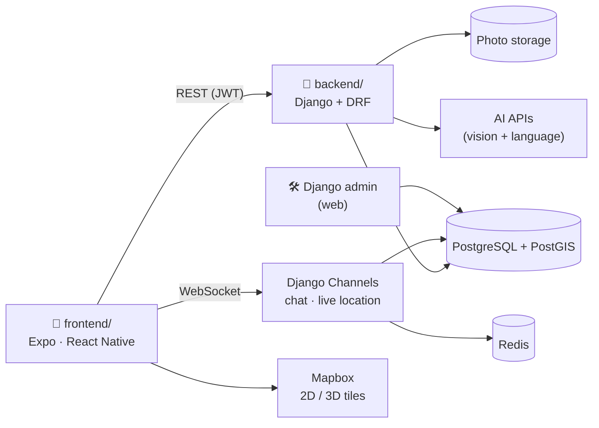

# Discover Kosovo: Project Plan

> **Team:** CommitCrew · **Course:** Menaxhimi i Projekteve (Prof. Lorent Sinani) · **Board:** [GitHub Project](https://github.com/users/rinorze/projects/1)
> **Timeline:** 11 weekly sprints, 19 Oct 2026 → 10 Jan 2027 (holiday break 28 Dec – 3 Jan)

This plan describes **what** we build, **which screens** come first, and **who builds what each week**. Every cell in section 6 is one card on the board: **one card per person per week**.

---

## 1. The product

**Discover Kosovo is a discovering + travelling + social media app for all 38 municipalities of Kosovo.**
You pick a city, find places on a 2D/3D map, go there, unlock each place with your camera, post the moment, and share it with friends: in the feed, in chat, and on the map.

**Core loop:** *see a friend's unlock → open the place → go there → snap it → unlock → your post shows up for your friends → they want to go too.*

**Product principles**
1. **Real visits only.** An unlock needs the in-app camera and your GPS inside the place's radius. That is what makes every post trustworthy.
2. **Social first.** Friends, feed, chat and the friends map are core, not extras.
3. **All of Kosovo.** Every municipality has a city page, even the smallest ones (Partesh, Junik, Mamushë).
4. **Beautiful and simple.** Big photos, rounded cards and glass buttons, in an iOS feel with Albanian and English everywhere.
5. **Private by default.** Location sharing is off until you turn it on. Ghost mode and city-level precision are always available.

---

## 2. What the research says

| App | What it does well | What we take |
| --- | --- | --- |
| **Instagram** | Photo feed, profiles, DMs, sharing | Feed + post card + profile grid; chat icon in the Home header |
| **Snapchat (Snap Map)** | Friends on a map, Ghost Mode, stories at places | Friends layer on the map; ghost mode; "who's here" at a place |
| **Bump** (Zenly's successor) | Live friends map, places you've been, chat | Friend preview sheet (last seen, chat, directions) |
| **Swarm / Foursquare** | Check-ins, stickers that unlock by place type, friends-only "mayors" | Unlock = check-in with proof; stamps by category; friends leaderboard |
| **Pokémon GO** | Going to real places to collect | The thrill of collecting by being physically there |
| **Polarsteps** | Trip tracking, 3D route flyovers, travel books | Trip recap and 3D flyover ideas (later) |
| **Strava** | Verified activity + kudos + segments | "Verified" badge on posts; friendly competition |
| **Fog of World / Been** | Visual progress of where you've been | City and region progress bars; "% of Kosovo discovered" |
| **Wanderlog / Mindtrip** | AI trip planning on a map | *Plan my day* with an itinerary on the map |
| **Visit Kosovo, Dardania Live, EduPrizrenin** | Information about places | Content sources, but they have **no** unlocks, social or chat; that gap is our opportunity |

**Key decisions from the research**
- **Backend: Python with Django** (+ Django REST Framework, GeoDjango, Django Channels). The built-in **Django admin** gives us the content and moderation panel for free. **GeoDjango + PostGIS** does the distance checks for unlocks. **Channels** gives WebSockets for chat and live location in the same codebase. FastAPI was considered, but it would need us to assemble auth, admin, geo and realtime ourselves.
- **Database: PostgreSQL + PostGIS** (places as points, municipalities as polygons), plus **Redis** for realtime.
- **Maps: Mapbox** (`@rnmapbox/maps`) for a real **2D ↔ 3D toggle**, with 3D terrain over Rugova and Sharr plus 3D buildings. MapLibre was our first choice because it is free, but it still has **no 3D terrain on mobile**. Mapbox has a free tier for mobile monthly active users. Both need an Expo **development build**.
- **AI runs only on the backend** (API keys never in the app): place Q&A over our own data, day plans, and a photo check for unlocks. *Note:* the Gemini API free tier is not available in Kosovo, so we budget a small paid key (OpenAI or similar) or a student credit.
- **Privacy model for friends on the map** (based on Snap Map, Find My and Life360): off by default, friends only, ghost mode, precision levels (city / ~1 km / exact), temporary sharing (1 hour, until tonight, until off).

**UX rules we adopt**
- Ask for each permission **in context**: location when the map first opens, camera on the first unlock, notifications after the first unlock. Never all at once, and the city grid works with no permissions at all.
- **Unlocking and posting are separate choices.** You can collect a stamp without publishing it.
- The in-app camera only (no gallery) for unlocks. Retake is always allowed, and a weak GPS signal means "wait", not "fail".
- Feed: chronological, friends + the selected city, no ranking algorithm at launch.
- Friends map: everyone starts in **ghost mode**, city-level precision by default, "last updated" on every avatar, no location history, no strangers, no heatmaps.
- Religious and memorial places (Deçan, Patriarchate of Peja, Graçanica, Prekaz) get a respectful visit card and **no** confetti, points or meetups.
- AI only answers with places that exist in our database, and the results are cards you can reorder, not a wall of text.

### Ideas unique to Kosovo
- **Kthimi (homecoming) mode:** in summer, the diaspora sees family municipalities first and "who else is back" (city level only).
- **The 38-city collection:** one stamp in every municipality, which is the top achievement.
- **Festival layers:** DokuFest (Prizren), Sunny Hill (Prishtina), Anibar (Peja). Stages and spots appear only during the festival and leave a limited stamp.
- **Rugova and Sharr in two seasons:** winter (Brezovica) and summer (Prevalla, Brod) sets with safety notes.
- **Çarshia open now:** craft workshops in Gjakova and Prizren flip their own "open today" switch.
- **Kulla keys:** a stone-tower-house set (Isniq, Dranoc, Junik, Deçan).
- **NEWBORN year stamp:** remembers the word painted on the monument the year you visited.
- **School trip mode:** a teacher code for a class trip with shared stamps, and never students' live location.

### Design direction (for Rinor)
- **Look:** big full-bleed photos in 24 px rounded cards, frosted circular glass buttons (44 pt), a hero card with title, author and *View more*, a *Discover* carousel, and a 2-column grid of city and place cards (3:4 photos, district chips on top).
- **Palette idea:** limestone `#F6F3EE` background · ink `#1A1814` · Kosovo blue `#1E4B99` (primary) · flag gold `#C6A15B` (stamps, never body text) · pine `#1B6B45` (unlocked) · terracotta `#B85A32` (food) · locked `#C8C2B8`. Dark mode: `#10141A` background, gold `#E2C27A`.
- **Type:** SF Pro on iOS and Inter or Source Sans 3 on Android (full ë/ç and Cyrillic support), scale 34/28/22/17/15/13.
- **Tools:** Figma (start from Apple's iOS UI kit), FigJam (flows), Mobbin (references), Rive or Lottie (stamp animation), Stark (contrast). Test Albanian text in every component, since it is longer than English.
- **Voice:** we say *unlock* and *stamps*, never "earn" or "passport" (in Kosovo a passport is an ID document). Other options from the research: *Mark / Shenjë* collected in a *Journal / Ditari*. Taglines: "See it. Snap it. Unlock it." · "Your map fills up when you show up." / "Harta jote mbushet kur ti del." · "38 komuna. Një hartë që e mbush ti."

---

## 3. Features (MoSCoW)

| Module | **Must** (MVP, final demo) | **Should** (planned) | **Could** (stretch) |
| --- | --- | --- | --- |
| Accounts | Sign up/in, profile setup, permissions, interests | Google sign-in, find friends | Email verification |
| Explore | All 38 cities grid, city page, place page, search, categories, saved places | Events and festival unlocks, city progress | Curated routes ("Rugova in a day") |
| Map | 2D map with places (locked/unlocked), place sheet, filters | **3D mode** (terrain + buildings), friends layer | 3D flyover to a city, offline cache |
| Unlock | In-app camera + GPS radius check, unlock animation, stamp, post composer | AI photo check, city/region completion stamps | Then & Now archive overlay, QR unlock indoors |
| Social | Feed (Following / For you), likes, comments, follow, profiles, notifications | Share, report/block, leaderboard | Stories, reposts |
| Chat | 1:1 chat with realtime messages | Group chats, share a place/post into chat | Photos and voice notes in chat |
| Friends map | — | Opt-in live location with ghost mode and precision | "Friends in Prizren this week" |
| AI | — | *Ask Kosovo* guide, *Plan my day* | Auto-translate captions sq↔en |
| Admin | Django admin: cities, places, events, users | Moderation of reports | Analytics dashboard |
| Quality | sq/en, demo mode (fake location), empty/error states | Push notifications | Offline unlock queue |

---

## 4. Navigation and screens

**Tab bar:** `Home` · `Explore` · `⊕ Unlock` (centre camera button) · `Map` · `Profile`
Home header: 💬 chats and 🔔 notifications. Explore header: ✨ *Ask Kosovo*.

| ID | Screen | Owner | Sprint |
| --- | --- | --- | --- |
| **A · Onboarding and accounts** | | | |
| A1 | Splash | Artiola | 2 |
| A2 | Welcome carousel (3 slides) | Artiola | 2 |
| A3 | Sign up | Artiola | 2 |
| A4 | Log in | Artiola | 2 |
| A5 | Forgot / reset password | Artiola | 2 |
| A6 | Permissions primer (location, camera, notifications) | Elvina | 2 |
| A7 | Profile setup (photo, name, home town or diaspora country) | Elvina | 2 |
| A8 | Interests and favourite cities | Elvina | 2 |
| A9 | Find friends | Artiola | 3 |
| **E · Explore** | | | |
| E1 | Explore home: hero card, *Discover* carousel, categories, events | Erleta | 3 |
| E2 | Cities grid: all 38, filter by region | Erleta | 2 |
| E3 | City detail: hero, about, top places, progress, posts | Erleta | 3 |
| E4 | Place detail: gallery, info, posts here, Unlock / Directions / Save | Elvina | 3 |
| E5 | Search: places, cities, people | Artiola | 4 |
| E6 | Category list | Erleta | 5 |
| E7 | Events list | Erleta | 6 |
| E8 | Event detail | Erleta | 6 |
| E9 | Saved places | Elvina | 3 |
| **M · Map** | | | |
| M1 | Map 2D with place pins and the 3D toggle | Erleta | 4 |
| M2 | Place preview sheet | Erleta | 4 |
| M3 | Filters (locked/unlocked, category, events) | Erleta | 5 |
| M4 | Friends layer + friend preview sheet | Erleta | 7 |
| **U · Unlock** | | | |
| U1 | Camera with "in range" indicator | Elvina | 4 |
| U2 | Not in range (distance to the nearest places) | Elvina | 4 |
| U3 | Verifying | Elvina | 5 |
| U4 | Unlocked! (stamp reveal) | Elvina | 5 |
| U5 | Post composer (caption, tag friends, visibility) | Elvina | 5 |
| U6 | Unlock failed (reason + what to do) | Elvina | 5 |
| **S · Social** | | | |
| S1 | Home feed: Following / For you | Artiola | 5 |
| S2 | Post detail | Artiola | 5 |
| S3 | Comments | Artiola | 6 |
| S4 | Notifications | Artiola | 6 |
| S5 | Other user's profile | Artiola | 4 |
| S6 | Followers, following, friend requests | Artiola | 7 |
| S7 | Report / block | Artiola | 8 |
| S8 | Share (to chat or outside the app) | Artiola | 8 |
| **C · Chat** | | | |
| C1 | Chats list | Elvina | 7 |
| C2 | Chat (1:1, realtime) | Elvina | 7 |
| C3 | New chat / new group | Elvina | 7 |
| C4 | Group info | Elvina | 8 |
| C5 | Share a place or post into a chat | Elvina | 8 |
| **I · AI** | | | |
| I1 | *Ask Kosovo* (AI guide chat) | Elvina | 8 |
| I2 | *Plan my day* (time, interests, start point) | Erleta | 8 |
| I3 | Day plan result (timeline + route on the map) | Erleta | 8 |
| **P · Profile** | | | |
| P1 | My profile: posts / stamps / map tabs | Artiola | 6 |
| P2 | Collection: stamps by region and city, with progress | Elvina | 6 |
| P3 | Stamp detail | Elvina | 6 |
| P4 | Leaderboard (friends, city) | Artiola | 8 |
| P5 | Edit profile | Artiola | 3 |
| P6 | Settings (language, notifications, account) | Artiola | 7 |
| P7 | Privacy and location sharing (ghost mode, precision) | Artiola | 7 |
| P8 | Blocked users, about, delete account | Artiola | 9 |

Rinor designs every screen **one sprint before** it is built (hi-fi in Figma, with loading, empty and error states).

---

## 5. Team

| Member | Role | Owns |
| --- | --- | --- |
| **Rinor Zeqiri** | Product Designer · Product Owner | Research, user flows, wireframes, design system, all hi-fi screens, prototype, usability tests, app icon, presentation visuals |
| **Elios Mernica** | Backend Lead (Python) | Django project, PostgreSQL/PostGIS, auth, cities and places API, unlock verification, stamps, AI endpoints, deploy |
| **Krenare Veseli** | Backend Developer · Scrum Master | Cities/places data model and admin, follows, posts, comments, notifications, chat (Channels), live location, moderation; sprint reviews and reports |
| **Artiola Ferizi** | Frontend Developer | Onboarding and auth screens, search, feed, posts, comments, notifications, profile, settings, privacy |
| **Erleta Qerimi** | Frontend Developer | App scaffold and tab bar, cities grid, Explore, city page, the 2D/3D map, events, *Plan my day* |
| **Elvina Sinani** | Frontend Developer | Permissions and profile setup, place page, camera unlock flow, collection and stamps, chat, *Ask Kosovo* |

**Content: all 38 municipalities split across the team** (city cover photo, sq/en description, and at least 3 places per municipality, entered through the Django admin):
Elios → Prishtinë region (8) · Krenare → Mitrovicë region (7) · Artiola → Prizren region (5) · Erleta → Pejë + Gjakovë regions (7) · Elvina → Ferizaj region (5) · Rinor → Gjilan region (6).

> The roles are a first proposal based on GitHub profiles. Swap them in Sprint 1 if skills differ.

---

## 6. Week by week

| Sprint | Rinor (design) | Elios (backend) | Krenare (backend · SM) | Artiola (frontend) | Erleta (frontend) | Elvina (frontend) |
| --- | --- | --- | --- | --- | --- | --- |
| **S1** 19–25 Oct · *Kickoff* | MVP doc to the professor; research and moodboard; user flows and sitemap | Django + PostGIS scaffold in `backend/` (Docker) | Working agreement; spike: Django Channels chat | Spike: Expo Router + forms | Expo scaffold in `frontend/` with 5 tabs | Spike: camera + GPS |
| **S2** 26 Oct–1 Nov · *Onboarding* | Design system v1; hi-fi A1–A9; wireframes for Explore and Map | Auth API (register, login, JWT, reset, me) | Region, municipality and place models + admin; seed all 38 cities | **A1–A5** splash, welcome, sign up, log in, reset | **E2** cities grid (38) + tab bar | **A6–A8** permissions, profile setup, interests |
| **S3** 2–8 Nov · *Cities and places* | Hi-fi Explore, city, place, search; map look (2D/3D) | Places API (by city, nearby, detail, search) + image upload | Follow / friends API + user search | **A9** find friends, **P5** edit profile, session handling | **E1** Explore home, **E3** city page | **E4** place page, **E9** saved places |
| **S4** 9–15 Nov · *Map* | Hi-fi map + unlock flow + stamp art | **Unlock API** (radius, accuracy, fake-GPS check, limits) + stamps | Posts API (photo upload, feed, likes) | **E5** search, **S5** other profile | **M1–M2** map 2D + place sheet + **3D toggle** | **U1–U2** camera, not in range |
| *Content* | Gjilan region | Prishtinë region | Mitrovicë region | Prizren region | Pejë + Gjakovë | Ferizaj region |
| **S5** 16–22 Nov · *Unlock and posts* | Hi-fi feed, post, comments, notifications, profile; **usability test #1** | Collection, progress and leaderboard API | Comments + notifications API | **S1–S2** home feed, post detail | **M3** filters, unlocked pins, **E6** categories | **U3–U6** verifying, unlocked!, composer, failed |
| **S6** 23–29 Nov · *Social and profile* | Hi-fi chat, friends map, collection | Events API + AI photo check | **Chat backend** (Channels + Redis, 1:1 and groups) | **S3–S4** comments, notifications, **P1** my profile | **E7–E8** events + city progress | **P2–P3** collection, stamp detail |
| **S7** 30 Nov–6 Dec · *Chat and friends* | Hi-fi AI screens; **usability test #2** | *Ask Kosovo* API (answers from our place data) | **Live location** (opt-in, ghost mode, precision) | **S6** followers/requests, **P6–P7** settings, privacy | **M4** friends on the map | **C1–C3** chats, chat, new chat |
| **S8** 7–13 Dec · *AI and engagement* | App icon, splash, store visuals | *Plan my day* API; staging deploy | Push notifications + moderation | **S7–S8** report/block, share, **P4** leaderboard | **I2–I3** plan my day + route on map | **I1** Ask Kosovo, **C4–C5** groups, share to chat |
| **S9** 14–20 Dec · *Polish and beta* | **Design QA + accessibility** | Security review + production deploy | **Beta test with 8+ users** + bug triage | **P8**, translations, empty states | Offline cache, map performance | Animations, chat polish |
| **S10** 21–27 Dec · *Release candidate* | Presentation deck + demo storyboard | Android release build | **Final report** | Bug fixes (own screens) | Bug fixes + demo data | Bug fixes |
| **S11** 4–10 Jan · *Final* | Demo video + case study | v1.0 release | Rehearsals + submission | Final QA | Demo phones checklist | Demo phones checklist |

Krenare's card also includes the weekly **sprint review**, and in Sprint 1 everyone's card includes a first **PR** to practise the workflow.

---

## 7. Architecture

| Layer | Choice |
| --- | --- |
| Frontend (`frontend/`) | Expo SDK 58 · React Native · TypeScript · Expo Router · `@rnmapbox/maps` · `expo-camera` · `expo-location` · TanStack Query · Zustand · i18next (sq/en) · Reanimated |
| Backend (`backend/`) | Python 3.12+ · Django 6.1 · Django REST Framework · GeoDjango · Channels + Redis · SimpleJWT · django-allauth · drf-spectacular (API docs) · Unfold (modern admin) · Celery |
| Database | PostgreSQL 17 + PostGIS: `Region`, `Municipality` (polygon), `Place` (point, unlock radius), `Unlock`, `Stamp`, `Post`, `Like`, `Comment`, `Follow`, `Conversation`, `Message`, `LocationShare`, `Event`, `Report` |
| Backend apps | `accounts` · `places` (regions, municipalities, places, events) · `unlocks` (verification, stamps) · `social` (posts, follows, feed) · `chat` · `location` · `notifications` · `ai` |
| Unlock check | In-app photo + GPS → `POST /api/unlocks/` → PostGIS `distance ≤ radius`, accuracy ≤ 75 m, no fake GPS, rate limit → stamp + post (AI photo check is added later) |
| Hosting (demo) | Docker locally · Render / Railway / Fly.io for Django · Neon or Supabase Postgres with PostGIS · Upstash Redis · Cloudflare R2 for photos |

---

## 8. How we work

- **Scrum with 1-week sprints.** Planning right after class, an async stand-up in the group chat (Mon / Wed / Fri: *done · next · blocked*), and a review in class.
- **Board:** one card per person per week, with a checklist inside. Columns: Todo → In Progress → In Review → Done. Views: *This week*, *All sprints*, *By person*, *My work*.
- **Git:** everyone pushes to **`staging`** (the default branch). When the week's work runs, it goes to `develop` and at the end of the sprint to `main`. Both are protected, so we always have a safe copy. Details are in [CONTRIBUTING.md](../CONTRIBUTING.md).
- **Definition of Done:** the card's checklist is ticked · pushed to `staging` with `Closes #card` · screenshots for screens · sq/en text · card in Done.

---

## 9. Risks

| Risk | Plan |
| --- | --- |
| Most of the team is new to React Native or Django | Spikes in S1, review pairs, Elios and Erleta unblock within 24 h |
| GPS or camera fails during the class demo | **Demo mode** (simulated location) and a recorded demo video |
| 3D maps or realtime turn out harder than planned | Fallbacks are ready: `react-native-maps` with a tilted satellite view instead of Mapbox, and chat that polls every 3 s instead of WebSockets. Live location is *Should* |
| Content for 38 municipalities takes long | Split by region across all 6 members; import candidates from OpenStreetMap/Wikidata |
| AI API costs or availability (no Gemini free tier in Kosovo) | Backend-only keys, per-user daily limits, AI features are *Should* |
| Privacy (live location, photos) | Off by default, ghost mode, precision levels, report/block, account deletion |
| Free hosting limits | Demo runs on free tiers; Docker keeps everything reproducible locally |

---

## 10. Final demo (definition of success)

1. A new user signs up, picks interests and opens the **cities grid with all 38 municipalities**.
2. They open Prizren, find a place on the map, **tilt to 3D**, and unlock the place with the camera (demo mode).
3. The unlock appears in a friend's **feed**; the friend likes it, comments, and **chats** about it.
4. The collection shows the new stamp and city progress; the friend sees them on the **friends map**.
5. *Ask Kosovo* answers "what should I see in Gjakova?" and *Plan my day* draws a route.
6. An admin adds a place in the Django admin and it appears in the app.

---

*Sources: [Koha: tourism 2025](https://www.koha.net/en/arberi/turizmi-gjeneroi-mbi-248-milione-euro-gjate-vitit-2025) · [RTV21: hotels July 2026](https://rtv21.tv/en/posts/rritet-numri-i-vizitorve-n-kosov-kto-jan-vendet-prej-nga-vijn-turistt) · [Wikipedia: Municipalities of Kosovo](https://en.wikipedia.org/wiki/Municipalities_of_Kosovo) · [MapLibre newsletter (no 3D terrain on Native yet)](https://maplibre.org/news/2026-04-01-maplibre-newsletter-march-2026/) · [Bump](https://apps.apple.com/us/app/-/id6471519217) · [Swarm](https://en.wikipedia.org/wiki/Foursquare_Swarm) · [Polarsteps summer 2026](https://www.polarsteps.com/news/polarsteps-launches-summer-2026-release-new-tools-for-planning-privacy-and-sharing) · [Snap Map Ghost Mode](https://www.online-tech-tips.com/what-is-ghost-mode-on-snapchat-and-how-to-turn-it-on/) · [Django vs FastAPI 2026](https://www.capitalnumbers.com/blog/django-vs-fastapi/) · research also done with Grok 4.7 and Cursor Composer.*
