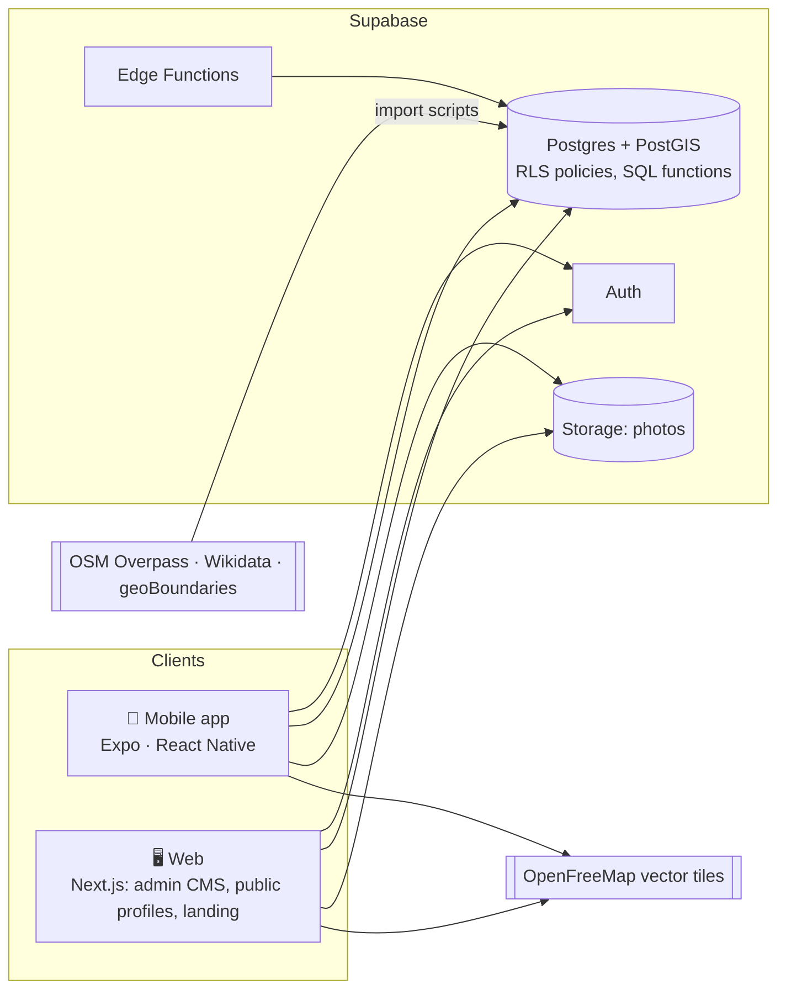

# Discover Kosovo — Project Plan (v2)

> **Team:** CommitCrew (6 members) · **Course:** Menaxhimi i Projekteve · **Instructor:** Lorent Sinani (`@lorentsinani`)
> **Timeline:** 11 one-week sprints, 19 Oct 2026 → 10 Jan 2027 · **Board:** [GitHub Project](https://github.com/users/rinorze/projects/1)

This document is the single source of truth for **what** we build, **who** builds it and **when**. Every task listed here exists as a GitHub issue on the project board, with an owner, sprint, priority, size and acceptance criteria.

---

## 1. Product in one paragraph

**Discover Kosovo is a social travel app where every post is a verified visit.** You explore a map of Kosovo's monuments, nature and hidden places. When you are physically there, you check in with the in-app camera. The photo becomes a post on your friends' feed, and a stamp lands in your digital *Passport of Kosovo*. Themed trails (**Besa Quests**), a map that "un-fogs" as you explore, and weekly leaderboards give people a reason to come back. Think *Instagram × Strava × a passport stamp book*, built for Kosovo.

| Pillar | What the user does | Key screens |
| --- | --- | --- |
| **Discover** | Browses the map, trending places, quests | Explore map · Place detail · Quests |
| **Visit & check in** | Goes there, takes a photo, gets verified | Check-in camera · Success |
| **Collect** | Earns stamps, XP, region progress | Passport · Achievements |
| **Share & connect** | Posts, follows, likes, comments, competes | Home feed · Profile · Notifications · Leaderboards |

**Core loop:** see a friend's post → open the place → go there → check in → your post appears in their feed → they want to go too.

**Audiences:** first-time international visitors · the diaspora coming home for summer and the holidays · local students and young people looking for weekend plans.

---

## 2. Review of the original concept (what changed and why)

We kept the strongest ideas from the first concept: photo-verified check-ins, the Kosovo Passport with stamps for the 7 regions, Besa Quests, the fog-of-war map, an admin CMS, OSM-based data import and a GPS simulator for live demos. We changed the following:

| # | Problem in the original plan | Fix in v2 |
| --- | --- | --- |
| 1 | **Scope:** about 30 features, including AI vision (CLIP), a RAG assistant, crypto-signed offline check-ins, Elo ranking, group multiplayer, NFC and TikTok import. Six students cannot ship that in 11 weeks, and nothing was prioritised. | Features are now prioritised with **MoSCoW** (§4): **P0** is required for the final demo, **P1** is planned, **P2** is stretch, and some ideas are explicitly *Won't*. |
| 2 | **Social was a side feature.** | **Social is now a core pillar:** a feed, follows, likes, comments, profiles and notifications. Every post comes from a verified check-in, which no other app offers. |
| 3 | **Duplicated stack:** MongoDB *and* PostGIS, NestJS/Express *and* Supabase, VisionCamera *and* expo-camera, two bottom-sheet libraries, "liquid glass" UI libraries. | One choice per layer (§5). **Supabase** (Postgres + PostGIS + Auth + Storage) replaces a custom Node API, so the team builds features instead of infrastructure. |
| 4 | **No timeline, milestones, Definition of Done or risk register.** | 11 sprints with goals, weekly deliverables per person, DoD, ceremonies and a risk register (§7–§10). |
| 5 | **No designer role.** UI work was hidden inside a "Mobile UI engineer" role. Nobody owned content (descriptions, photos, translations). | A dedicated **Product Designer**. Content is split by region across the whole team (§6). |
| 6 | **Unverified statistics.** €248M is an estimate by the Tourism Union, not an official figure. The diaspora figure of 600k was an interim registration count; later reports say about 550k. Download counts for competitor apps come from aggregators. | Section 3 cites sources and labels estimates as estimates. |
| 7 | **Legal and safety gaps:** user content without moderation, location privacy, image licensing. | We add report/block, an admin moderation queue, privacy settings, account deletion and photo attribution. These are required by App Store guideline 1.2 for user-generated content and by Kosovo's data-protection law, which is aligned with GDPR (§9). |
| 8 | **The ChatGPT revision cut too far:** a web-only app, no social features, and generic "role" tasks with no concrete deliverables. | A mobile-first app plus a web admin. Every issue has concrete tasks and acceptance criteria. |

---

## 3. Why now (verified context)

- **Tourism is growing.** Kosovo registered **762,836 visitors in 2025, 60.7% of them international**, with 1.65M overnight stays ([Koha](https://www.koha.net/en/arberi/turizmi-gjeneroi-mbi-248-milione-euro-gjate-vitit-2025)). The Tourism Union *estimates* their spending at about €248M.
- **Record summer.** **99,053 hotel visitors in July 2026**, up 27.8% on July 2025, according to the Kosovo Agency of Statistics ([RTV21](https://rtv21.tv/en/posts/rritet-numri-i-vizitorve-n-kosov-kto-jan-vendet-prej-nga-vijn-turistt)).
- **A large diaspora.** Roughly 550,000–600,000 people registered in the 2024 diaspora census (interim figures; [Kossev](https://www.kossev.info/en/kosovo-online-news-kosovo-extends-diaspora-census-deadline-to-december-amid-ongoing-registration-efforts/), [Prishtina Insight](https://prishtinainsight.com/headcount-results-show-kosovo-faces-declining-population-and-rising-urbanization/)). They return every summer and winter.
- **The market gap.** Existing apps are catalogues or city utilities: Visit Kosovo, the *Dardania Live* guide launched in May 2026, EduPrizrenin and Prishtina Online. **None of them verifies a visit or has a social loop.** The gap is not missing information; it is the lack of a reason to open the app again tomorrow.

---

## 4. Scope (MoSCoW)

### P0 · Must have: the final demo depends on these
1. **Accounts and profiles:** sign up/in, onboarding with permission primers, username, avatar, home town or diaspora country, university.
2. **Explore:** a map of more than 60 curated places across all **7 regions** (Prishtinë, Prizren, Pejë, Gjakovë, Mitrovicë, Gjilan, Ferizaj), place sheet and detail page, search and category filters.
3. **Verified check-in:** in-app camera only, GPS inside the place's radius (default 100 m), validated on the server. The result is a **verified post** plus a **stamp**.
4. **Home feed:** *Following* and *Community* tabs, post cards with a "Verified visit" badge, likes, comments and post detail.
5. **Social graph:** follow/unfollow, user profiles (post grid and passport), in-app notifications, **report and block**.
6. **Passport:** stamps grouped by region, progress per region, stamp detail.
7. **Besa Quests:** at least 5 multi-stop themed trails with progress and a completion badge.
8. **Admin CMS (web):** places, quests and events CRUD with image upload, a moderation queue and a dashboard.
9. **Albanian and English** across the whole UI.
10. **Demo mode:** a location simulator and realistic demo data for the classroom presentation.

### P1 · Should have: planned, built after P0 is stable
XP and levels · weekly leaderboards (friends, city, university) · fog-of-war map · events with time-limited festival stamps (DokuFest, Sunny Hill, Anibar, Hardh Fest) · "Want to go" saved places · share post / share card · deep links · public web profile `discoverkosovo…/u/username` · landing page with privacy policy and terms · offline read cache · offline check-in queue · settings (privacy, language, delete account).

### P2 · Could have: stretch, only if a sprint finishes early
"Then & Now" ghost camera overlay with archive photos · AI photo check (a vision model flags mismatches for moderators) · trivia question after a check-in · audio micro-stories (TTS) · push notifications · AI trip planner · trip recap card · hidden-gem submissions · German language · QR check-in for indoor museums · group check-in ("Sofra Mode").

### Won't have (this semester)
Business coupons and QR rewards · TikTok/Instagram import · direct messages and stories (moderation burden) · RAG chat assistant · SOS/GPX hiking tracker · expense tracker · NFC · fully offline vector maps · public App Store or Play Store release (we distribute an APK).

---

## 5. Architecture and tech stack

| Layer | Choice | Why |
| --- | --- | --- |
| Mobile | **Expo SDK 58** (React Native 0.88, React 19), **Expo Router**, TypeScript | One codebase for Android and iOS, file-based routing, the latest stable SDK (Oct 2026). |
| Map | **MapLibre React Native 11** + **OpenFreeMap** tiles + a custom style designed in Maputnik | Free with no API key or billing, the brand-styled map is fully ours, and the same style works on the web. Needs an Expo **development build** (it does not run in Expo Go). |
| Geo maths | **Turf.js** | Fog of war (buffer, union, difference), distances. |
| Camera / GPS | `expo-camera`, `expo-location` | In-app capture and accuracy; Android reports mocked locations. |
| App state | **TanStack Query** (server state, cache, offline persistence) + **Zustand** (UI state) | Less boilerplate and caching built in. |
| UI | Design tokens from Figma, Reanimated 4, `expo-haptics`, `react-native-svg` (stamp generator), FlashList (feed) | Smooth feed and stamp animations. |
| i18n | `i18next` + `react-i18next` + `expo-localization` | Albanian and English from day one. |
| Backend | **Supabase:** Postgres + **PostGIS**, Auth, Storage, Row Level Security, Edge Functions | No custom server to build or host. Geo queries (`ST_DWithin`) run in SQL. The free tier is enough. |
| Web | **Next.js 16** (App Router), Tailwind CSS 4, shadcn/ui, `@supabase/ssr`, `maplibre-gl`, hosted on **Vercel** | Fast admin forms, server-rendered public pages. |
| Monorepo | **pnpm workspaces + Turborepo:** `apps/mobile`, `apps/web`, `packages/shared`, `supabase/` | Shared types, schemas and tokens. Six people work in parallel without conflicts. |
| Quality | ESLint, Prettier, TypeScript strict, Vitest, **Maestro** (mobile E2E), Playwright (web smoke), **GitHub Actions** CI | Every PR is checked automatically. |
| Data | OSM Overpass + Wikidata/Wikimedia Commons (CC licences) + geoBoundaries (CC BY 4.0) + manual curation | Real coordinates and licensed photos with attribution. |
| Design | Figma (+ FigJam), Maputnik, Lottie | See [design brief](design/DESIGN-BRIEF.md). |

The data model, check-in verification and repository layout are described in **[ARCHITECTURE.md](ARCHITECTURE.md)**.

---

## 6. Team and responsibilities

| Member | Role | Owns |
| --- | --- | --- |
| **Rinor Zeqiri** `@rinorze` | **Product Designer (UI/UX lead) · Product Owner** | Research, personas, IA and flows, wireframes, visual identity, Figma UI kit and design tokens, all hi-fi screens, map style, stamp system, motion, usability tests, design QA, presentation visuals. Final say on UX and scope priorities. |
| **Elios Mernica** `@eliosmernica15` | **Tech Lead: backend, data and DevOps** | Architecture decisions, monorepo, Supabase schema and RLS, SQL/RPC functions (check-in, feed, quests, gamification), storage, data import pipeline, security review, builds and releases. Lead reviewer. |
| **Artiola Ferizi** `@artiolaferizi` | **Web Developer · QA lead** | Next.js admin CMS (places, quests, events), moderation queue, dashboard, public web profile, landing page. Also the test plan, CI, beta test and bug bashes. |
| **Erleta Qerimi** `@erletaqerimi-oss` | **Mobile Developer: Explore and quests** | App shell and navigation, MapLibre map, place detail, search and filters, demo mode, visited/saved states, fog of war, Besa Quests UI, offline cache. |
| **Elvina Sinani** `@elvinasinani-netizen` | **Mobile Developer: check-in and passport** | Auth screens, onboarding, camera and check-in flow, passport and stamp component, XP/levels, events and festival stamps, settings, offline check-in queue. |
| **Krenare Veseli** `@krenareveselii` | **Mobile Developer: social · Scrum Master** | Home feed, post detail, comments, profiles, follow system, notifications, report/block, leaderboards, sharing. Also sprint planning, reviews and retros, board hygiene and the final report. |

> The mapping of the five developer roles to people is a **first proposal** based on GitHub profiles. Swap roles in the first week if skills differ (reassign issues by filtering the board by assignee).
> **Content is split across the whole team:** in Sprint 4 every member curates about 10 places for one region (Prishtinë: Elios · Prizren: Artiola · Pejë: Erleta · Gjakovë: Elvina · Mitrovicë/Vushtrri: Krenare · Gjilan and Ferizaj: Rinor).
> **Review pairs:** Erleta ↔ Elvina · Krenare ↔ Artiola · Elios reviews backend and anything risky · Rinor reviews every PR that changes UI (design QA).

---

## 7. Timeline: 11 sprints

Each sprint runs Monday → Sunday and is checked in class every week. Design works **one sprint ahead** of development (dual-track). Sprint 11 is placed after the New Year break. *If the course calendar differs, change the dates under Project → Settings → Sprint.*

| Sprint | Dates | Goal (definition of success) | Phase |
| --- | --- | --- | --- |
| **S1 · Kickoff** | 19–25 Oct | MVP approved by the professor; everyone has merged a first PR; research and tech spikes are done | Inception |
| **S2 · Foundations** | 26 Oct–1 Nov | Monorepo, DB schema v1, app shell with 5 tabs, sign-in works; IA and wireframes | Inception |
| **S3 · Design system and data** | 2–8 Nov | Visual identity and UI kit; the map shows real places from Supabase; admin login | Alpha |
| **S4 · Discovery and content** | 9–15 Nov | 60+ places in all 7 regions; place detail; admin places CRUD; hi-fi feed, explore and check-in | Alpha |
| **S5 · Check-in and feed** | 16–22 Nov | **A real check-in creates a verified post that appears in the feed** | Core loop |
| **S6 · Passport and community** | 23–29 Nov | Stamps in the passport; notifications; report/block; moderation queue | Core loop |
| **S7 · Quests** | 30 Nov–6 Dec | Besa Quests playable end to end; XP/levels; usability test #2; public web profile | Beta |
| **S8 · Leaderboards and events** | 7–13 Dec | Leaderboards, fog of war, festival stamps; **beta test with 8+ external users** | Beta |
| **S9 · Polish and hardening** | 14–20 Dec | Design QA and accessibility, security review, offline, E2E tests, bug bash | Release |
| **S10 · Release candidate** | 21–27 Dec | RC APK and production backend; every P0 bug fixed; final report drafted | Release |
| — | 28 Dec–3 Jan | *Holiday break (buffer)* | — |
| **S11 · Final delivery** | 4–10 Jan | v1.0.0 released, presented and submitted | Release |

### Sprint-by-sprint deliverables per person

| Sprint | Rinor (Design) | Elios (Backend) | Artiola (Web/QA) | Erleta (Explore) | Elvina (Check-in) | Krenare (Social/SM) |
| --- | --- | --- | --- | --- | --- | --- |
| **S1** | Competitor audit; personas and journey map; send MVP to professor | ADRs; Supabase project | Spike: Next.js + Supabase auth | Spike: MapLibre in a dev build | Spike: camera + GPS | Working agreement; spike: feed list |
| **S2** | IA and user flows; lo-fi wireframes | **Monorepo scaffold**; DB schema v1 + RLS | CI pipeline; content plan (60 places) | App shell: 5 tabs, theme, i18n | Auth screens | Feed UI on mock data |
| **S3** | Visual identity; Figma UI kit and tokens | OSM/Wikidata import; places API | Admin login and layout | **Explore map v1** | Onboarding and profile setup | Profile screen |
| **S4** | Hi-fi feed and explore; hi-fi check-in and stamps | Storage buckets; **check-in RPC** | **Admin places CRUD** | Place detail | Check-in camera screen | Follow system |
| **S4 content** | Gjilan + Ferizaj | Prishtinë | Prizren | Pejë | Gjakovë | Mitrovicë/Vushtrri |
| **S5** | Hi-fi social and passport; map style and pins; usability test #1 | Feed, likes and comments backend | Admin quests; test plan | Demo mode; search and filters | **Check-in end to end** | **Live feed**, likes, comments |
| **S6** | Hi-fi quests and web pages; motion spec | Gamification and leaderboards backend | Moderation queue | Visited states; place photos | **Passport** and stamp component | Notifications; report/block |
| **S7** | Usability test #2; app icon and splash | Quests backend | Public web profile | **Besa Quests UI** | XP/levels; settings | Share and deep links |
| **S8** | Empty states and microcopy; events design | Events backend | Landing page; admin events; **beta test** | Fog of war | Events and festival stamps | Leaderboards |
| **S9** | **Design QA and accessibility audit** | Security and performance review; AI check (P2) | Bug bash; production web deploy | Offline cache | Offline check-in queue; ghost camera (P2) | Maestro E2E; people suggestions |
| **S10** | Presentation deck and demo storyboard | **RC build** and production DB | Web fixes; admin guide | Fixes; demo seed data | Fixes and animation polish | Fixes; **final report** |
| **S11** | Demo video; design case study | **v1.0.0 release** | Final web deploy | Final demo checks | Final demo checks | Rehearsals; **submission** |

Every member also has a weekly **sprint review** item (owned by Krenare) and takes part in the final presentation.

### Epics on the board

Every task is a sub-issue of one epic, so the progress bars on the **Epics** view show how far each area is.

| Epic | Owner | Epic | Owner |
| --- | --- | --- | --- |
| [#2 Project management and Scrum](https://github.com/rinorze/menaxhimi-projekteve-commitcrew/issues/2) | Krenare | [#8 Social: feed, follows, likes, comments](https://github.com/rinorze/menaxhimi-projekteve-commitcrew/issues/8) | Krenare |
| [#3 UX research and design system](https://github.com/rinorze/menaxhimi-projekteve-commitcrew/issues/3) | Rinor | [#9 Passport, stamps and gamification](https://github.com/rinorze/menaxhimi-projekteve-commitcrew/issues/9) | Elvina |
| [#4 Platform, backend and DevOps](https://github.com/rinorze/menaxhimi-projekteve-commitcrew/issues/4) | Elios | [#10 Besa Quests](https://github.com/rinorze/menaxhimi-projekteve-commitcrew/issues/10) | Erleta |
| [#5 Accounts, onboarding and settings](https://github.com/rinorze/menaxhimi-projekteve-commitcrew/issues/5) | Elvina | [#11 Web: admin, moderation, public pages](https://github.com/rinorze/menaxhimi-projekteve-commitcrew/issues/11) | Artiola |
| [#6 Explore: map and discovery](https://github.com/rinorze/menaxhimi-projekteve-commitcrew/issues/6) | Erleta | [#12 Content and data (60+ places)](https://github.com/rinorze/menaxhimi-projekteve-commitcrew/issues/12) | Artiola |
| [#7 Verified check-in and posts](https://github.com/rinorze/menaxhimi-projekteve-commitcrew/issues/7) | Elvina | [#13 Quality, release and presentation](https://github.com/rinorze/menaxhimi-projekteve-commitcrew/issues/13) | Artiola |

---

## 8. How we work (Scrum, lightweight)

| Ceremony | When | Output |
| --- | --- | --- |
| **Sprint planning** (20 min) | Right after the weekly class | Sprint items moved to *Todo*, each with one owner |
| **Async stand-up** | Mon / Wed / Fri in the group chat | "Done · Next · Blocked" in 3 lines |
| **Sprint review** (in class) | Weekly class hour | Demo of merged work; the professor checks the board |
| **Retro** (10 min) | Right after the review | `docs/sprints/sprint-NN.md`: keep, change, try |

**Board columns:** Backlog → Todo → In Progress → In Review → Done. Move your card yourself; a PR linked with `Closes #N` moves it to Done when it merges.

**Definition of Ready:** a clear goal, acceptance criteria, an owner, a sprint, a size, and dependencies done or planned earlier. UI tasks also need a design (wireframe or hi-fi).

**Definition of Done:**
- [ ] All acceptance criteria are met and shown in the PR (screenshots or video for UI).
- [ ] The PR is reviewed and approved by 1 teammate (Rinor too, if it changes UI) and CI is green.
- [ ] Merged into `develop` with no secrets, and Albanian and English strings are added.
- [ ] The issue is closed and the board is updated.

**Sizes (points):** 1 = a couple of hours · 2 = half a day · 3 = about a day · 5 = 2–3 days · 8 = most of the sprint (split it if possible).

Git workflow and PR rules are in **[CONTRIBUTING.md](../CONTRIBUTING.md)**.

---

## 9. Risks and mitigations

| Risk | Likelihood | Impact | Mitigation |
| --- | --- | --- | --- |
| Team members are new to React Native | High | High | Spikes in S1, pair programming, review pairs, the tech lead unblocks within 24 h |
| GPS or camera fails in the classroom demo | High | High | **Demo mode** (S5) and a recorded demo video as backup (S11) |
| The feed looks empty in the demo | Medium | High | Demo seed users and posts (S10); beta testers create real posts (S8) |
| Scope creep (the original 30-feature list) | High | High | MoSCoW; P2 work only after the sprint's P0 work is done; the Product Owner decides |
| Content takes longer than expected | Medium | Medium | Content is split across all 6 members; the import script pre-fills coordinates and descriptions |
| Cheating (fake GPS, photo of a photo) | Medium | Medium | In-app camera only, server-side distance check, mocked-location rejection, rate and impossible-travel limits, AI check (P2), moderation |
| Inappropriate user content | Medium | High | Report/block, moderation queue, terms of use (App Store 1.2) |
| Personal data (location, photos) | Medium | High | Consent at onboarding, only the place is stored (not continuous tracking), account deletion, privacy policy (Kosovo Law 06/L-082) |
| Supabase free project pauses after 7 days idle | Low | Medium | Weekly activity; restore from the dashboard; `supabase/` migrations reproduce the database |
| Image licensing | Medium | Medium | Only Wikimedia Commons (CC), our own photos, or photos with permission; attribution is stored per image |
| Holiday break and exams in December–January | Medium | Medium | Buffer week; RC ready by 27 Dec |

---

## 10. Success criteria for the final demo

1. A new user installs the APK, signs up and completes onboarding in under 2 minutes.
2. They find a place on the map, check in using demo mode, and see a **verified post** in a friend's feed and a **stamp** in their passport.
3. A friend likes and comments; the author gets a notification.
4. A Besa Quest shows progress and completes with a badge.
5. The admin adds a new place on the web and it appears on the phone's map.
6. A reported post is hidden from the moderation queue.
7. Every screen works in Albanian and English.
8. The board shows 11 closed sprints, with every member owning merged PRs.

---

## 11. Sources

Tourism: [Koha](https://www.koha.net/en/arberi/turizmi-gjeneroi-mbi-248-milione-euro-gjate-vitit-2025) · [RTV21](https://rtv21.tv/en/posts/rritet-numri-i-vizitorve-n-kosov-kto-jan-vendet-prej-nga-vijn-turistt) · [EU Transition Pathways: Kosovo tourism data](https://transition-pathways.europa.eu/tourism/data/monthly-visitor-and-overnight-stay-trends-kosovo). Diaspora: [Kossev](https://www.kossev.info/en/kosovo-online-news-kosovo-extends-diaspora-census-deadline-to-december-amid-ongoing-registration-efforts/) · [Prishtina Insight](https://prishtinainsight.com/headcount-results-show-kosovo-faces-declining-population-and-rising-urbanization/). Competitors: [Dardania Live listing](https://mwm.ai/apps/dardania-live/6769425753). Tech: [Expo SDK 58](https://expo.dev/changelog/sdk-58) · [MapLibre RN + Expo](https://maplibre.org/maplibre-react-native/docs/setup/expo) · [OpenFreeMap](https://openfreemap.org) · [Supabase + Expo](https://supabase.com/docs/guides/getting-started/quickstarts/expo-react-native) · [Supabase PostGIS](https://supabase.com/docs/guides/database/extensions/postgis) · [geoBoundaries](https://www.geoboundaries.org). Policy: [App Store Review Guidelines §1.2](https://developer.apple.com/app-store/review/guidelines/#user-generated-content) · [Kosovo Law 06/L-082 on Personal Data](https://www.dataguidance.com/sites/default/files/law_no._06_l_-082_on_protection_of_personal_data_0.pdf) · [GitHub Projects](https://docs.github.com/en/issues/planning-and-tracking-with-projects).
